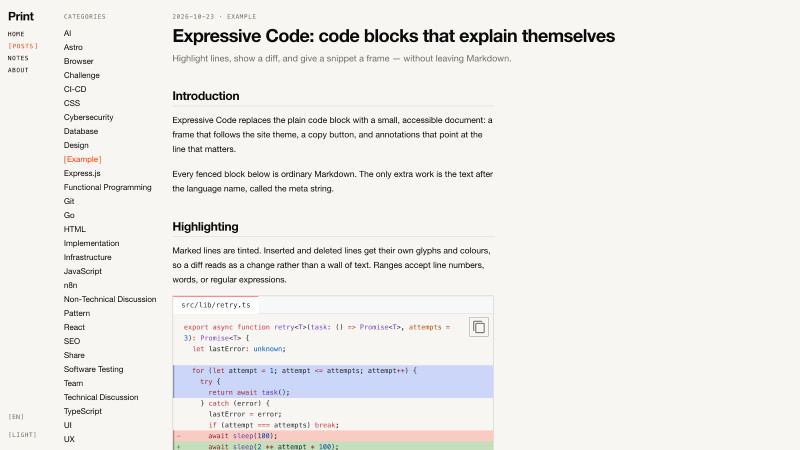

# Print

> A minimal, TUI-inspired blog theme powered by Astro v7 - [demo](https://riceball-tw.github.io/print/en/)



## Features

- **TUI aesthetic** — blinking cursor, `[bracketed]` nav items, monospace metadata, hairline rules, light & dark themes
- **[Mermaid diagrams](https://riceball-tw.github.io/print/en/posts/mermaid-gallery/)** — 30+ diagram types (flowchart, sequence, C4, Wardley map, Gantt, git graph…) rendered to **static SVG at build time** via [Pele](https://pele.run/), themed with the same CSS variables as the rest of the page — zero client-side JavaScript
- **[Expressive Code](https://riceball-tw.github.io/print/en/posts/expressive-code-demo/)** — syntax highlighting, editor & terminal frames, line markers, word highlighting, and a copy button on every code block, themed by the site's light/dark toggle
- **Built-in i18n** — English, 简体中文, 繁體中文 out of the box
- **Two content types** — long-form `post`s and feed-style `note`s, each with its own index, detail page, and category pages
- **Deploy anywhere** — [GitHub Pages](https://pages.github.com/) or [Cloudflare Pages](https://pages.cloudflare.com/), configured in one workflow

## Getting Started

```sh
git clone https://github.com/riceball-tw/print.git .
pnpm install
pnpm run dev        # http://localhost:4321
```

### Commands

| Command          | Action                                         |
| :--------------- | :--------------------------------------------- |
| `pnpm dev`       | Starts the dev server at `localhost:4321`      |
| `pnpm build`     | Builds the production site into `./dist/`      |
| `pnpm preview`   | Previews the production build locally          |
| `pnpm test`      | Runs the Vitest unit tests                     |
| `pnpm test:e2e`  | Builds the site and runs the Playwright suites |
| `pnpm typecheck` | Runs `astro check`                             |
| `pnpm lint`      | Runs oxlint                                    |
| `pnpm fmt`       | Formats the source with oxfmt                  |

### Customization

| What                                   | Where                                  |
| :------------------------------------- | :------------------------------------- |
| Site config (brand, nav, social links) | `src/data/config.json`                 |
| Posts & notes                          | `src/content/post`, `src/content/note` |
| Translations                           | `src/i18n/ui.ts`                       |
| Styles & tokens                        | `src/styles/global.css`                |
| Expressive Code themes                 | `ec.config.mjs`                        |
| Deployment base path                   | `astro.config.mjs`                     |

### Writing Content

Content lives in `src/content/{post|note}/{lang}/{slug}/index.mdx`.

```mdx
---
isDraft: false
headline: "Your Post Title"
excerpt: "A short description."
category: "Category"
publishDate: 2026-01-01
---
```

Draft posts (`isDraft: true`, the default) are visible in development and excluded from production builds.

### Deployment

`.github/workflows/deploy.yml` supports two targets that run in parallel after the build:

| Target               | Setup                                                                                                 |
| :------------------- | :---------------------------------------------------------------------------------------------------- |
| **GitHub Pages**     | Set repo variable `PUBLIC_BASE_URL` to the repo name (e.g. `print`)                                   |
| **Cloudflare Pages** | Uncomment the `deploy-cloudflare` job; add `CLOUDFLARE_API_TOKEN` and `CLOUDFLARE_ACCOUNT_ID` secrets |

For a custom domain or Cloudflare, leave `PUBLIC_BASE_URL` empty or set it to the full URL.

## Project Structure

```text
/
├── e2e/                 # Playwright end-to-end tests
├── public/              # static assets (favicon, images)
├── src/
│   ├── components/      # Astro components
│   ├── content/         # posts and notes
│   ├── data/            # site config (config.json)
│   ├── i18n/            # translations
│   ├── layouts/         # page shell
│   ├── pages/           # routes
│   ├── styles/          # global.css
│   └── utils/           # pure helpers
├── astro.config.mjs
├── ec.config.mjs
├── playwright.config.ts
└── vitest.config.ts
```

## License

MIT
