Every diagram below is written as a plain fenced code block in this MDX file. A
Sätteri plugin turns the fence into a component, Pele renders it to SVG during
`astro build`, and the result is inlined into the HTML. There is no client-side
JavaScript, and the colors come from the same CSS variables that flip when you
switch to dark mode.

<p class="label">Core</p>

- [Flowchart](#flowchart)
- [Swimlane](#swimlane)
- [Sequence](#sequence)
- [Class](#class)
- [State](#state)
- [Entity relationship](#entity-relationship-er)
- [Use case](#use-case)

<p class="label">Planning</p>

- [Gantt](#gantt)
- [Timeline](#timeline)
- [User journey](#user-journey)
- [Kanban](#kanban)
- [Quadrant chart](#quadrant-chart)

<p class="label">Data and charts</p>

- [Pie chart](#pie-chart)
- [XY chart](#xy-chart)
- [Radar](#radar)
- [Treemap](#treemap)
- [Sankey](#sankey)
- [Packet](#packet)

<p class="label">Structure</p>

- [Mindmap](#mindmap)
- [Tree view](#tree-view)
- [Block](#block)
- [Architecture](#architecture)
- [C4](#c4)
- [Requirement](#requirement)
- [Venn](#venn)

<p class="label">Specialised</p>

- [Git graph](#git-graph)
- [Event modeling](#event-modeling)
- [Cynefin](#cynefin)
- [Wardley map](#wardley-map)
- [Ishikawa](#ishikawa)
- [Railroad](#railroad)
- [Agentflow](#agentflow)
- [Info](#info)

## Flowchart

The pipeline this post goes through.

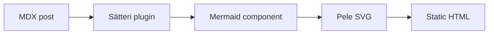

## Swimlane

The same build, split by who owns each step.

```mermaid
swimlane-beta LR
  subgraph Writer
    write[Write a post]
    review[Review preview]
  end
  subgraph Astro
    build[Build site]
    valid{Diagram valid?}
  end
  write --> build --> valid
  valid -->|yes| review
  valid -->|no| write
```

## Sequence

A request for one diagram, from editor to browser.

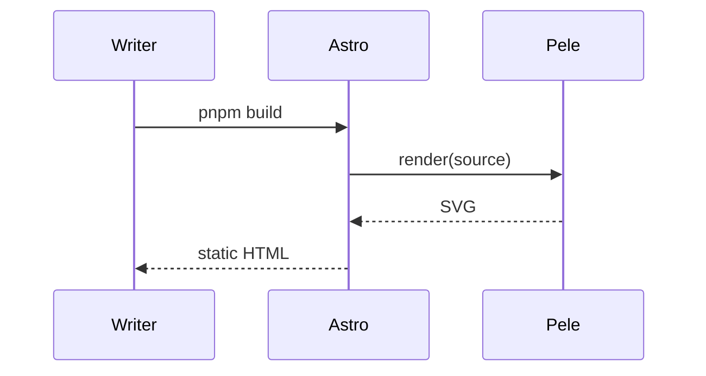

## Class

The two pieces of the component boundary.

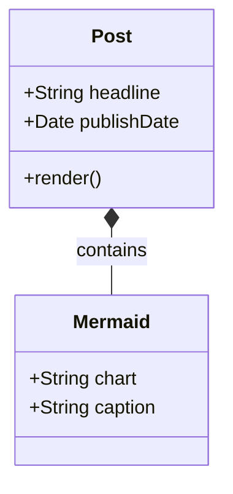

## State

The lifecycle of a post.

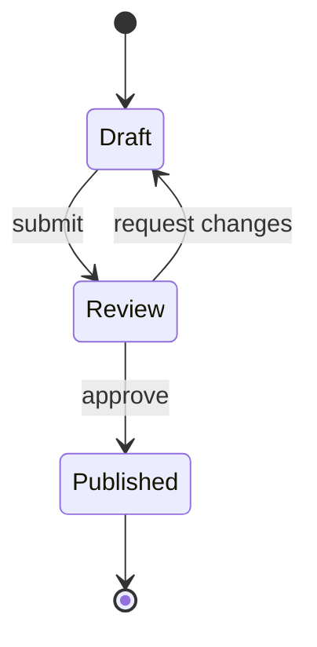

## Entity relationship (ER)

The content collection, reduced to two tables.

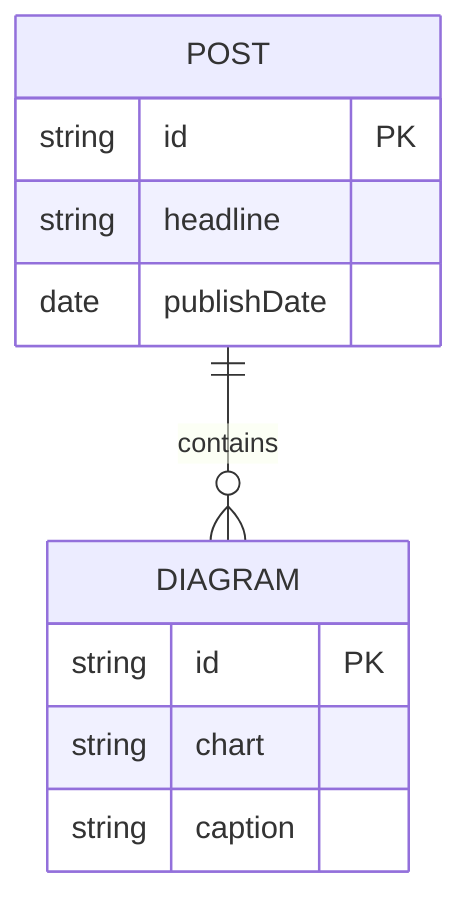

## Use case

What a writer and a reader can do.

```mermaid
usecase-beta
direction LR
actor Writer
actor Reader
Browse("Read a post")
Publish("Publish a diagram")
Writer --> Publish
Reader --> Browse
Publish ..> : include Browse
```

## Gantt

A plausible two-week schedule for one post.

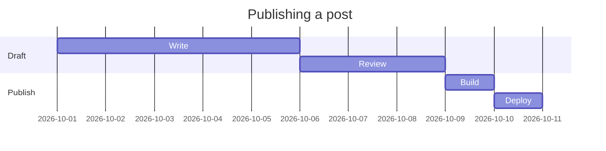

## Timeline

How the rendering approach changed.

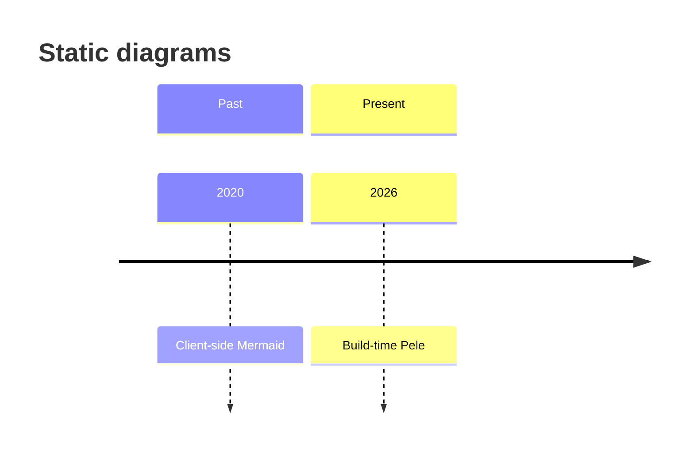

## User journey

The experience of adding one diagram.

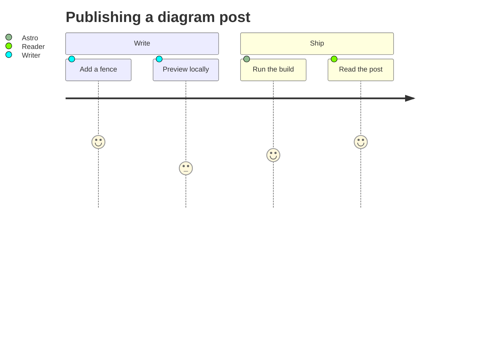

## Kanban

A small editorial board.

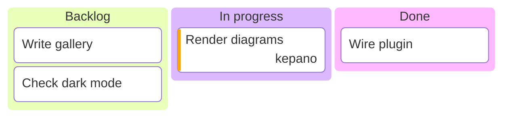

## Quadrant chart

Where the heavier diagram types sit.

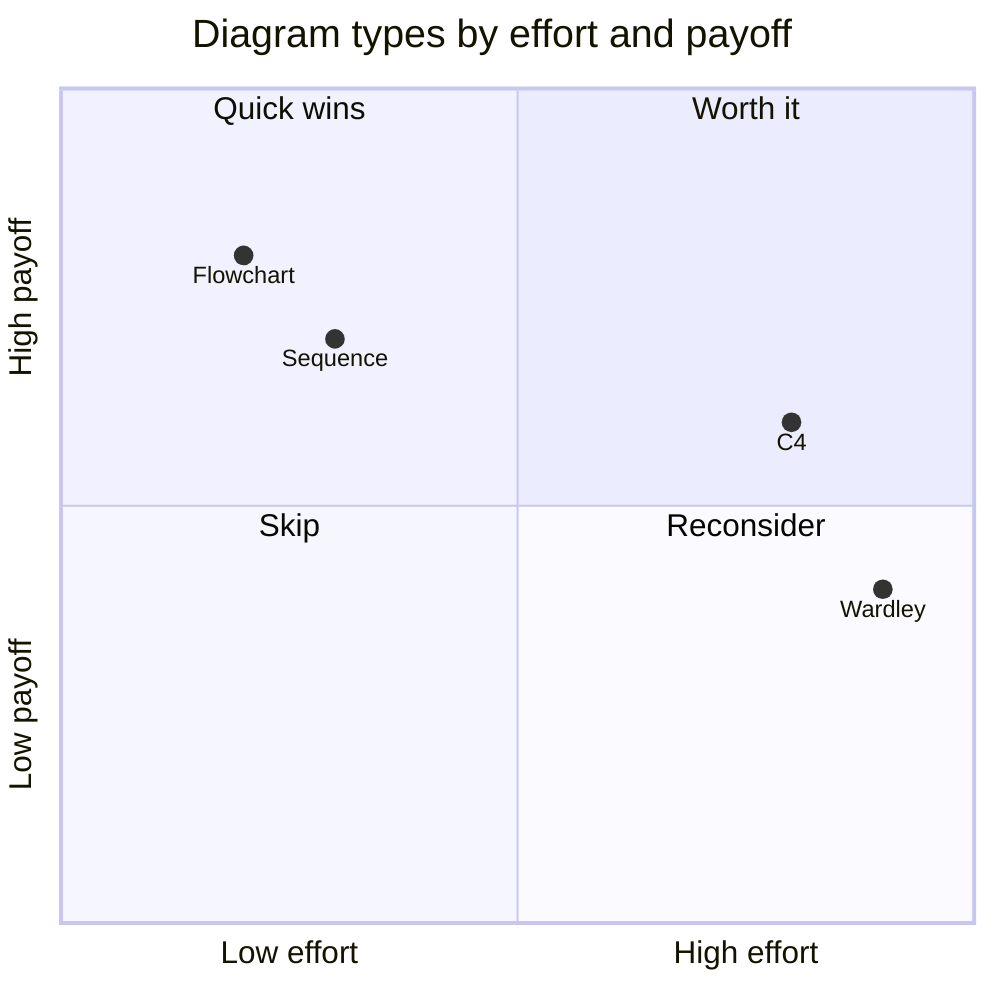

## Pie chart

A rough split of the gallery itself.

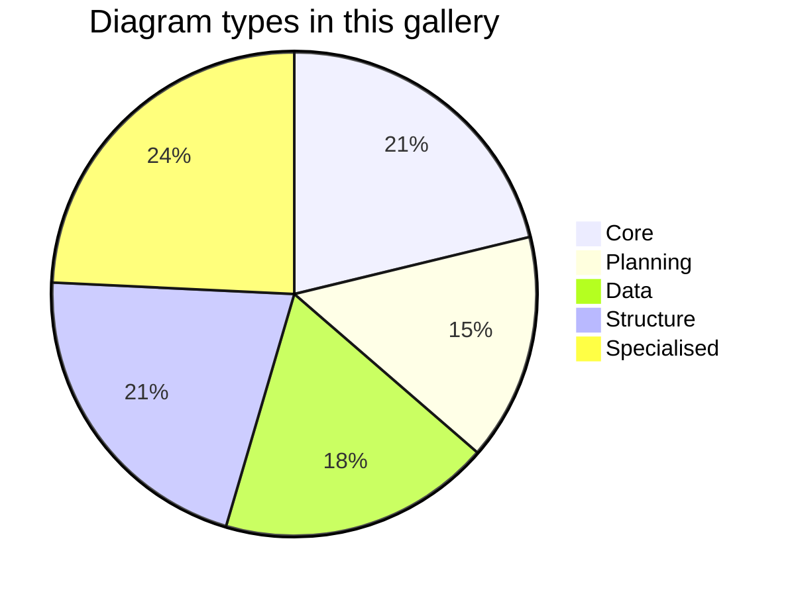

## XY chart

Invented line counts, for the shape of the chart.

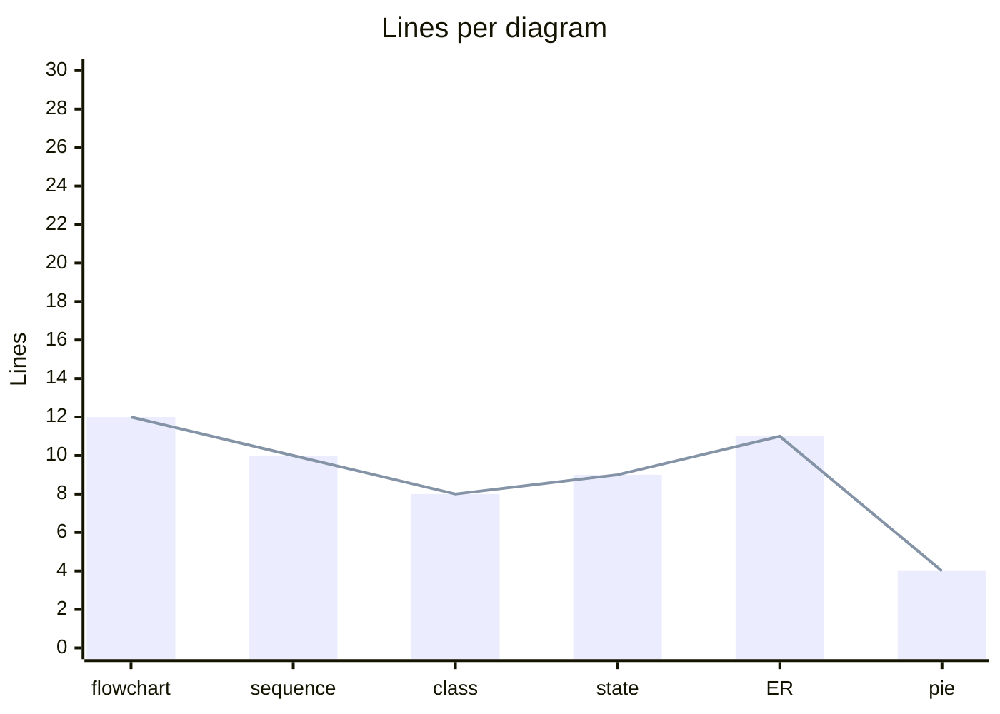

## Radar

Pele against the reference implementation, on axes that matter here.

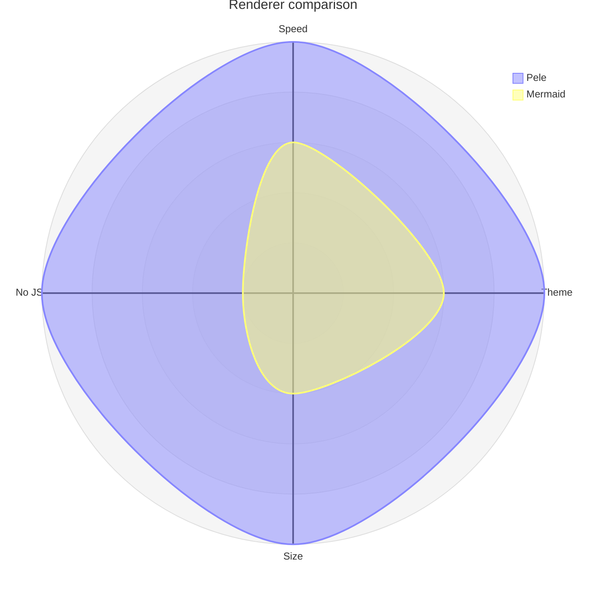

## Treemap

Where a build's time goes, roughly.

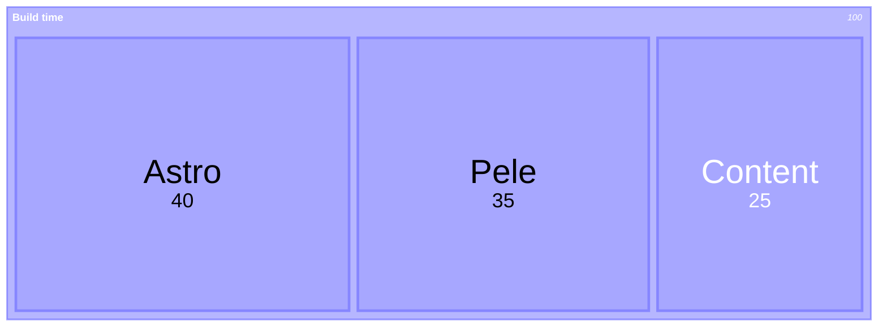

## Sankey

Content flowing into output formats.

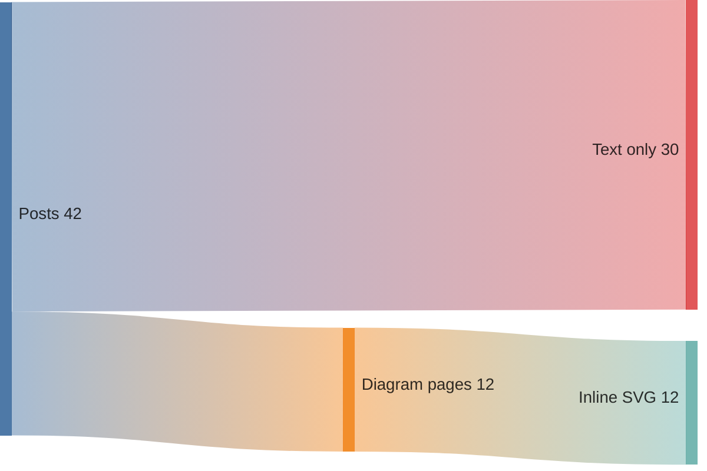

## Packet

Not network traffic, but the same idea: fixed-width fields.

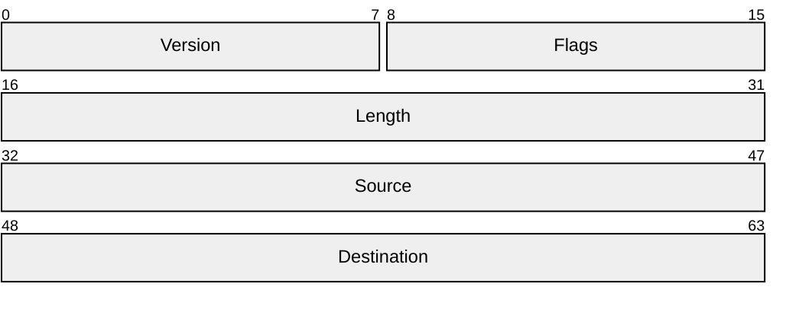

## Mindmap

The stack, from content to presentation.

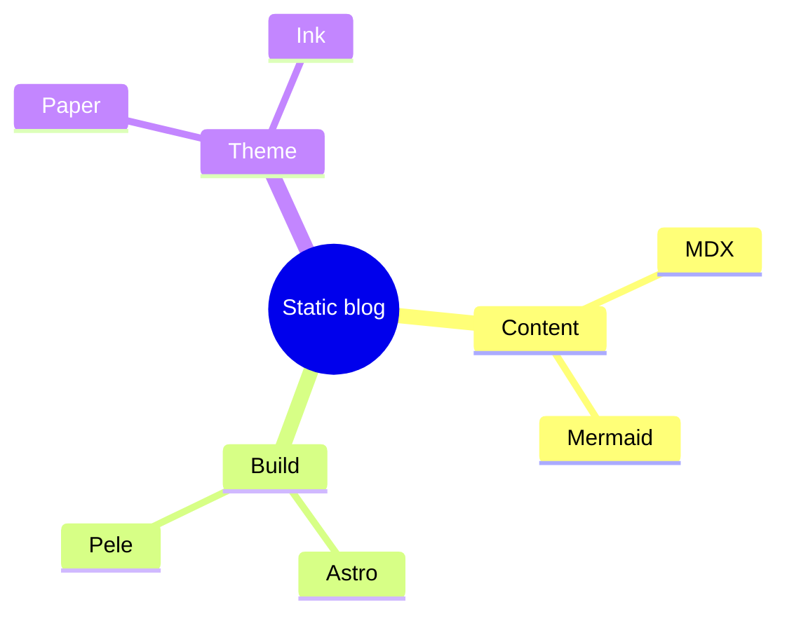

## Tree view

The files involved in this feature.


## Block

The pipeline again, as blocks rather than a graph.

```mermaid
block
  columns 3
  a["MDX"] b["Plugin"] c["SVG"]
  a --> b
  b --> c
```

## Architecture

The build groups and the two services inside them.

```mermaid
architecture-beta
  group build(cloud)[Build]
    service astro(server)[Astro] in build
    service pele(server)[Pele] in build
  group output(disk)[Output]
    service html(disk)[HTML] in output
  astro:R --> L:pele
  pele:R --> L:html
```

## C4

The same system at the context level.

```mermaid
C4Context
  title Blog build
  Person(writer, "Writer", "Writes MDX posts")
  System(astro, "Astro", "Builds the static site")
  System(pele, "Pele", "Renders Mermaid to SVG")
  Rel(writer, astro, "Runs pnpm build")
  Rel(astro, pele, "Calls render()")
```

## Requirement

One non-functional requirement, satisfied by the renderer.

```mermaid
requirementDiagram
  requirement static_svg {
    id: 1
    text: Diagrams must be in the initial HTML.
    risk: medium
    verifymethod: test
  }
  element pele {
    type: renderer
  }
  pele - satisfies -> static_svg
```

## Venn

Three properties this approach shares.

```mermaid
venn-beta
  title Static, themeable, fast
  set Static
  set Themeable
  set Fast
  union Static,Themeable["No client JS"]
  union Themeable,Fast["Cheap redraws"]
  union Static,Fast["Cached builds"]
  union Static,Themeable,Fast["Pele"]
```

## Git graph

A short feature branch, as one does.

```mermaid
gitGraph
  commit id: "init"
  branch post
  commit id: "draft"
  checkout main
  commit id: "theme"
  checkout post
  commit id: "mermaid"
  checkout main
  merge post id: "merge"
```

## Event modeling

The same build as events rather than calls.

```mermaid
eventmodeling

timeframe 01 ui PostEditor
timeframe 02 command Publish
timeframe 03 event PostPublished
timeframe 04 processor BuildSite
timeframe 05 event SiteDeployed
```

## Cynefin

A deliberately loose classification of diagram choices.

```mermaid
cynefin-beta
  title Where diagrams fit
  clear
    "Flowcharts"
  complicated
    "Architecture"
  complex
    "Wardley maps"
  chaotic
    "Incident sketches"
```

## Wardley map

The pieces of this site, positioned by visibility and maturity.

```mermaid
wardley-beta
  title Blog stack
  anchor Reader [0.95, 0.60]
  component Astro [0.60, 0.55]
  component Pele [0.45, 0.40]
  component Mermaid syntax [0.30, 0.70]
  Reader -> Astro
  Astro -> Pele
  Pele -> Mermaid syntax
```

## Ishikawa

Causes of a slow build, grouped the usual way.

```mermaid
ishikawa-beta
  Slow build
  Content
    Too many diagrams
    Large MDX files
  Renderer
    Heavy layout
    Missing cache
  Tooling
    No incremental build
    Slow CI
```

## Railroad

The tiniest grammar for a diagram fence.

```mermaid
railroad-ebnf-beta
title Pipeline grammar

pipeline = fence ;
fence = "fence-open" source "fence-close" ;
source = { character } ;
```

## Agentflow

A beta flow syntax for agent-style pipelines.

```mermaid
agentflow-beta TB
  flow intake["Intake"]
    receive["Read fence"]@{ shape: input }
  end
  flow render["Render"]
    parse["Parse"]@{ shape: task }
    draw["Draw SVG"]@{ shape: task }
    parse --> draw
  end
  receive --> parse
```

## Info

The smallest supported diagram: renderer information.

```mermaid
info
```

External Mermaid plugins such as ZenUML are not supported by Pele. See its
[compatibility notes](https://pele.run/compatibility) for the full list and the
differences from the reference implementation.
